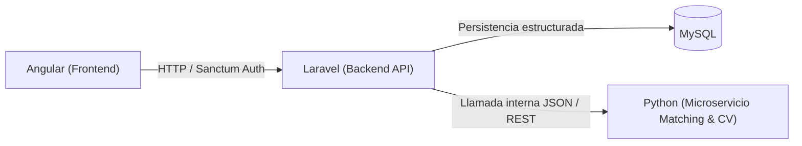

# EP-04: Coincidencia Candidato-Vacante e Importación de CV

**Estado:** Abierto / Comprometido  
**Iteración:** Sprint final — Demo 4  
**Origen:** Cliente / CHG-03  
**Repositorios asociados:**
- `JH-Compan/matching-service-empleo` (Issue #1)
- `JH-Compan/recruitment-api-empleo` (Issue #86)

---

## 1. Visión General y Objetivo

Implementar capacidades de procesamiento especializado mediante **Python** para:
1. **Calcular la compatibilidad** entre las habilidades técnicas de los candidatos y los requisitos de una vacante mediante un algoritmo ponderado (70% Must-Have / 30% Nice-to-Have con penalizaciones).
2. **Priorizar postulantes** por parte de las Empresas mediante porcentajes de compatibilidad en el Kanban/tablero.
3. **Importar información de CV** en PDF/DOCX mediante una plantilla oficial, permitiendo al Candidato revisar, editar y confirmar los datos antes de guardarlos en su perfil, respetando los catálogos del sistema.

Todo ello integrado con la aplicación web mediante **Laravel**, conservando la autenticación (Sanctum), autorización y reglas de negocio del sistema.

---

## 2. Arquitectura de Integración

### Responsabilidades por Componente
- **Angular:** Interfaz de usuario (postulación, Kanban de empresa, carga y revisión editable de CV). Consume **únicamente** endpoints de Laravel; nunca invoca directamente a Python.
- **Laravel + Sanctum:** Autenticación, autorización de roles (Empresa vs. Candidato), validación de relaciones candidato-vacante, orquestación interna hacia Python, validación de catálogos y persistencia en MySQL.
- **Python:** 
  - Cálculo especializado de compatibilidad técnica (`POST /api/v1/match`).
  - Extracción y análisis estructurado de CV según la plantilla oficial.
  - No gestiona autenticación de usuarios finales ni escribe directo en la BD.
- **MySQL:** Base de datos relacional para postulaciones, resultados de compatibilidad calculados, perfiles y catálogos normalizados.

---

## 3. Algoritmo de Compatibilidad (Matching)

### 3.1 Variables
- $M_c$: Habilidades *Must-Have* coincidentes.
- $M_t$: Total de habilidades *Must-Have* requeridas.
- $N_c$: Habilidades *Nice-to-Have* coincidentes.
- $N_t$: Total de habilidades *Nice-to-Have* requeridas.

> **Regla estricta:** Solo se consideran habilidades técnicas basadas en ID de catálogo normalizado (sin texto libre, sin habilidades blandas). Los IDs repetidos o habilidades extra del candidato no añaden puntos adicionales.

### 3.2 Coincidencia Base ($S_{\text{base}}$)
$$S_{\text{base}} = 0.70 \times \left(\frac{M_c}{M_t}\right) + 0.30 \times \left(\frac{N_c}{N_t}\right)$$

- **Categorías vacías:** Si $M_t = 0$, la contribución Must-Have es 0. Si $N_t = 0$, la contribución Nice-to-Have es 0. **No se redistribuyen pesos** y se evita división entre cero.

### 3.3 Penalización por Must-Have
- **Caso A ($M_c / M_t < 0.50$):** Menos del 50% de Must-Have cumplidas $\rightarrow$ **Score Final = 0**.
- **Caso B ($0.50 \le M_c / M_t < 1.00$):** Al menos 50% pero falta alguna Must-Have $\rightarrow$ **Score Final = $S_{\text{base}} \times 0.50 \times 100$**.
- **Caso C ($M_c / M_t = 1.00$):** Cumple el 100% de Must-Have $\rightarrow$ **Score Final = $S_{\text{base}} \times 100$**.

### 3.4 Redondeo y Rango
- Resultado entero entre `0` y `100`.
- Redondeo estándar al entero más cercano; valores terminados exactamente en `.5` se redondean hacia arriba.

---

## 4. Historias de Usuario

### HU-07: Calculadora Compatibilidad Candidato-Vacante (#2)
- **Actor:** Candidato (desencadena al postular) / Empresa (consulta).
- **Endpoint interno:** `POST /api/v1/match`
- **Flujo:** Al registrarse una postulación válida en HU-05, Laravel prepara los IDs de habilidades y llama a Python. El resultado entero se persiste en MySQL asociado a la postulación.
- **Seguridad y Privacidad:** Solo la Empresa dueña de la vacante puede ver el porcentaje. El Candidato **no** puede ver su porcentaje de compatibilidad.

---

### HU-08: Ordenar Candidatos por Porcentaje de Compatibilidad
- **Actor:** Empresa / Reclutador.
- **Función:** Permite ordenar los postulantes dentro de las columnas del Kanban de mayor a menor score.
- **Reglas:**
  - El ordenamiento **no** cambia de etapa automáticamente a ningún candidato (no altera estados Contratado/Rechazado).
  - Candidatos con score 0% son válidos y se ubican por encima de los pendientes.
  - Candidatos con score pendiente ("Compatibilidad pendiente") aparecen al final.
  - Empates se resuelven por **fecha de postulación** (más antiguo primero).
  - Los scores provienen de MySQL (no se llama a Python al ordenar).

---

### HU-18: Gestionar Indisponibilidad Temporal del Servicio de Matching (#4)
- **Objetivo:** Garantizar la resiliencia y continuidad del negocio.
- **Reglas:**
  - Si Python no responde o falla, la postulación en Laravel **no se pierde**.
  - No bloquear la consulta general de postulantes ni alterar el estado del proceso de selección.
  - Identificar a los candidatos afectados con el estado **"Compatibilidad no disponible" / "Compatibilidad pendiente"**.
  - **Prohibido generar porcentajes inventados o asumir 0% por error.**
  - Permitir el recálculo posterior una vez restablecido el microservicio.

---

### HU-25: Importar Información del CV al Perfil del Candidato (#86)
- **Actor:** Candidato (durante registro HU-01 o edición de perfil).
- **Formatos:** DOCX o PDF generados a partir de la **plantilla oficial descargable**.
- **Reglas Funcionales Clave:**
  - **RF-CV-01 / 02:** La plantilla contiene campos estructurados y listas de catálogos vigentes.
  - **No creación automática:** No se deben crear habilidades, idiomas ni carreras en los catálogos a partir del documento.
  - **Extracción estructurada (Python):** Extrae datos personales, formación, experiencia, idiomas, habilidades técnicas y blandas.
  - **Valores no reconocidos:** Se muestran advertencias y el usuario puede seleccionar una opción del catálogo o descartarla.
  - **Revisión y confirmación obligatoria:** Los datos extraídos se muestran en un resumen editable en Angular; nunca se guardan directamente en MySQL sin la confirmación expresa del Candidato.
  - **Actualización selectiva:** En perfiles existentes, el candidato elige qué secciones o campos actualizar.
  - **Alternativa manual:** Siempre disponible en caso de fallo o preferencia del usuario.

---

## 5. Decisiones Técnicas y Pendientes
1. Tratamiento exacto de vacantes sin habilidades Must-Have ($M_t = 0$).
2. Política de recálculo ante actualización posterior de habilidades en perfil o vacante.
3. Mecanismo de generación y versionado de la plantilla oficial DOCX y su detección en PDF.
4. Contrato OpenAPI / JSON definitivo y timeouts para `POST /api/v1/match` y el endpoint de procesamiento de CV.
5. Definición de requerimientos para EP-05 (pendiente de recepción).

