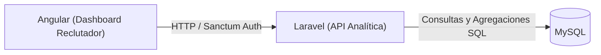

# EP-05: Analítica de Reclutamiento

**Estado:** Abierto / Comprometido  
**Iteración:** Sprint final — Demo 4  
**Origen:** Cliente / CHG-03  
**Repositorios asociados:**
- `JH-Compan/recruitment-api-empleo` (Issue #4 — Épica)
- `JH-Compan/recruitment-api-empleo` (Issue #28 — HU-09)
- `JH-Compan/recruitment-api-empleo` (Issue #29 — SPIKE)

---

## 1. Visión General y Objetivo

Proporcionar a las Empresas un dashboard de analítica de sus procesos de reclutamiento mediante indicadores derivados de las vacantes, postulaciones y habilidades técnicas registradas en la plataforma.

Permite analizar el comportamiento de sus convocatorias y apoyar la toma de decisiones basada en información real y persistida en MySQL, orquestada y autorizada por Laravel + Sanctum y presentada en Angular.

> [!NOTE]
> **No se requiere invocar a Python** para los cálculos analíticos de esta épica. Todos los cálculos se realizan a partir de los datos transaccionales persistidos en MySQL mediante Laravel.

---

## 2. Arquitectura y Componentes

- **Angular:** Filtros semanales (lunes a domingo, UTC-5), gráficos comprensibles, diseño responsive y soporte de modo claro/oscuro sin gráficos redundantes.
- **Laravel + Sanctum:** Autenticación y autorización estricta por Empresa (aislamiento multi-tenant: una empresa solo ve sus vacantes y postulaciones). Métricas de candidatos agregadas sin exponer datos personales ajenos.
- **MySQL:** Fuente de datos transaccionales histórica y actual.
- **Exclusiones confirmadas:** Dashboard administrativo (HU-21) y auditoría administrativa (HU-23) quedan fuera del alcance.

---

## 3. Reglas Temporales Generales (SPIKE #29)

1. **Período semanal:** Semanas de **lunes a domingo**.
2. **Zona horaria:** Hora de Perú (**UTC−5**).
3. **Eventos temporales:**
   - Publicación de vacantes (posterior al pago).
   - Finalización de vacantes (por cupos o vencimiento).
   - Registro de postulación.
   - Contratación de postulantes.
4. **Indicadores dinámicos:** La analítica no es una fotografía inmutable; contrataciones posteriores aumentan la conversión de la semana original de postulación, y la oferta/disponibilidad de habilidades se calcula con los perfiles vigentes. Sin comparación contra la semana anterior.

---

## 4. Definición de Indicadores y Fórmulas

### 4.1 Vacantes Activas
- **Definición:** Cantidad de vacantes de la Empresa que fueron publicadas y pagadas durante la semana seleccionada y que **no han pasado al estado `Finalizada` al momento de la consulta**.
- **Estados:** Vacantes `Pausada` u `Oculta` se contabilizan si cumplen la condición de publicación/pago y no finalizada. Vacantes finalizadas quedan excluidas.

### 4.2 Tiempo Promedio de Cierre
- **Definición:** Duración promedio transcurrida desde la publicación efectiva (post-pago) hasta el paso a `Finalizada` (por cupos cubiertos o vencimiento según HU-14), para vacantes finalizadas **dentro de la semana seleccionada**.
- **Fórmula:**
  $$\text{Duración} = \text{Fecha/hora finalización} - \text{Fecha/hora publicación}$$
  $$\text{Promedio} = \frac{\sum \text{Duración de vacantes finalizadas}}{\text{Cantidad de vacantes finalizadas}}$$
- **Unidad y Formato:** Días enteros (descartando fracción / redondeado). Si no hay vacantes finalizadas en el período: `"Sin datos"`.

### 4.3 Conversión de Postulaciones (%)
- **Definición:** Porcentaje de postulaciones registradas en la semana seleccionada que alcanzaron el estado `Contratado` (incluso si la contratación ocurrió en una semana posterior).
- **Fórmula:**
  $$\text{Conversión (\%)} = \left(\frac{\text{Postulaciones de la semana que alcanzaron Contratado}}{\text{Total de postulaciones registradas en esa semana}}\right) \times 100$$
- **Reglas críticas:**
  - **Postulaciones retiradas (HU-16):** Permanecen en el denominador histórico; **no** se consideran contratadas ni se eliminan del historial.
  - Si denominador = 0 $\rightarrow$ `"Sin datos"`.
  - Si denominador > 0 y 0 contratados $\rightarrow$ `0%`.

### 4.4 Total de Postulantes por Vacante
- Cantidad de postulaciones registradas en cada vacante de la Empresa durante la semana o universo temporal aplicable. Si no hay postulantes, contexto válido es `0`.

### 4.5 Oferta de Habilidades Técnicas
- **Definición:** Número de candidatos distintos registrados en toda la plataforma que poseen una habilidad técnica $h$ solicitada por las vacantes publicadas de la Empresa.
- **Reglas:** Solo habilidades de tipo **técnico** del catálogo normalizado (sin blandas). Candidatos únicos globales (no restringido solo a quienes postularon a la empresa, pero sin exponer datos personales).
- Si nadie la posee $\rightarrow$ `0`.

### 4.6 Disponibilidad de Habilidades Técnicas (%)
- **Definición:** Porcentaje de candidatos registrados en la plataforma que poseen la habilidad técnica $h$.
  $$\text{Disponibilidad}(h) \ (\%) = \left(\frac{\text{Candidatos registrados que poseen } h}{\text{Total de candidatos registrados en la plataforma}}\right) \times 100$$
- Si no hay candidatos registrados en la plataforma $\rightarrow$ `"Sin datos"`. Si hay candidatos y ninguno tiene $h$ $\rightarrow$ `0%`.

### 4.7 Avisos de Baja Disponibilidad
- **Condición:** Si $\text{Disponibilidad}(h) < 20\%$.
- **Comportamiento:** Mensaje informativo de advertencia sugiriendo revisar o flexibilizar el requisito. No altera automáticamente las vacantes ni elimina habilidades.
- Si $\text{Disponibilidad}(h) \ge 20\%$ no se muestra el aviso.

---

## 5. Manejo de Estados sin Datos

| Situación | Representación |
| :--- | :--- |
| Conteo válido sin registros (ej. 0 postulantes, 0 contratados) | `0` |
| Promedio indefinido (ej. 0 vacantes finalizadas) | `"Sin datos"` |
| Porcentaje con denominador 0 | `"Sin datos"` |
| Disponibilidad con 0 candidatos registrados | `"Sin datos"` |
| Errores de consulta | Error controlado (nunca reemplazar por 0 ni inventar datos) |

---

## 6. Historias de Usuario de EP-05

- **HU-09 — Panel de consulta de análisis de reclutamiento (#28):**
  - Implementación del frontend Angular y endpoints Laravel para visualización de los 5 bloques de indicadores filtrados por semana (UTC-5), con control estricto de acceso multi-empresa.
- **SPIKE — Definir reglas de cálculo de métricas de reclutamiento (#29 - Cerrado):**
  - Definición aprobada de fórmulas, tratamiento temporal dinámico, reglas de postulaciones retiradas y casos de prueba QA-S29-01 al QA-S29-15.

